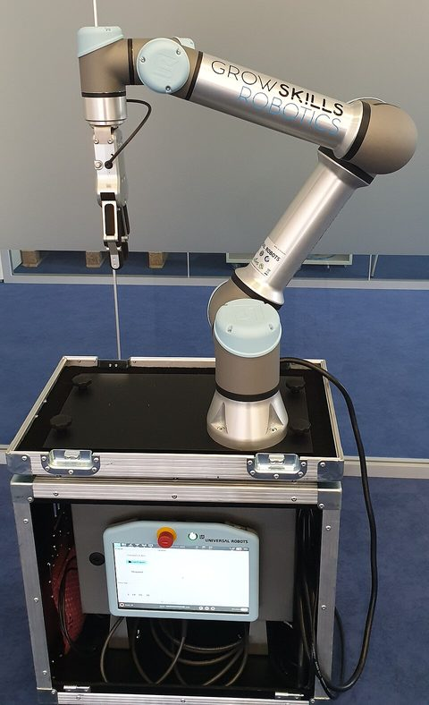
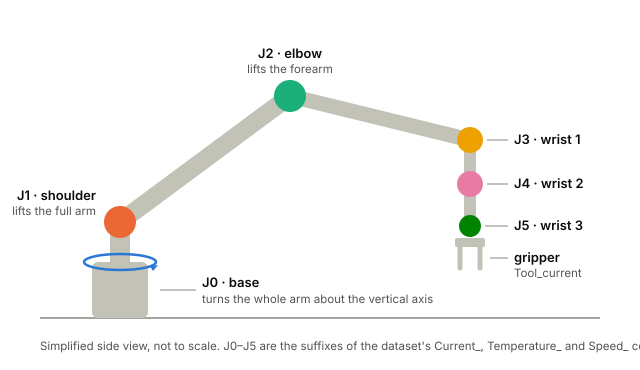
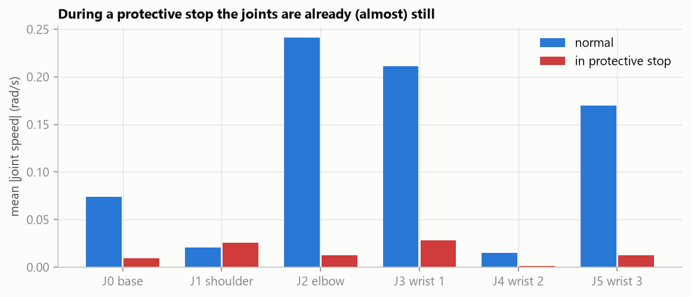
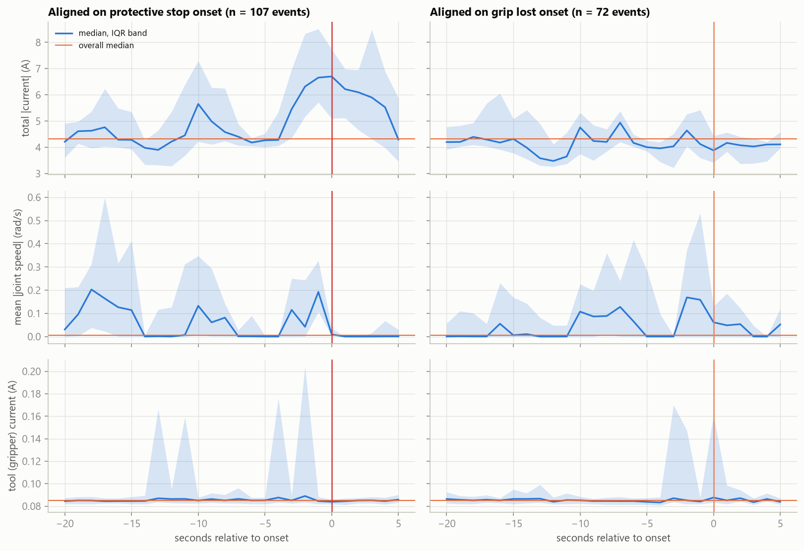
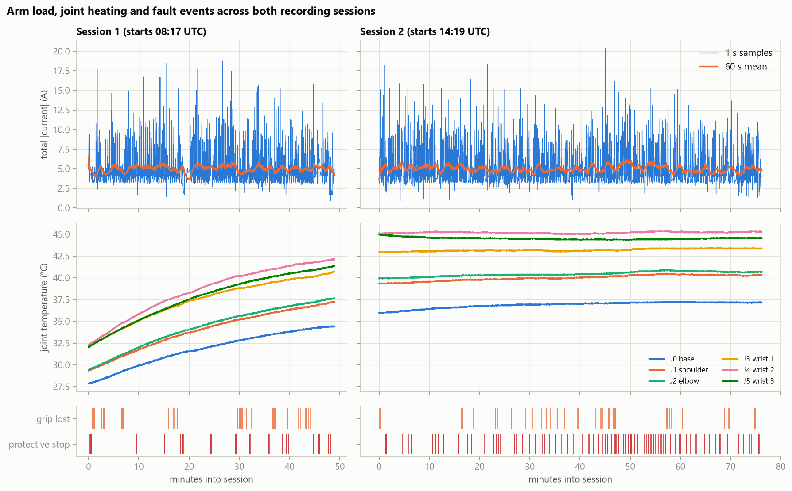
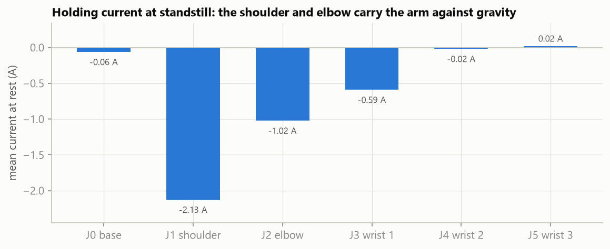
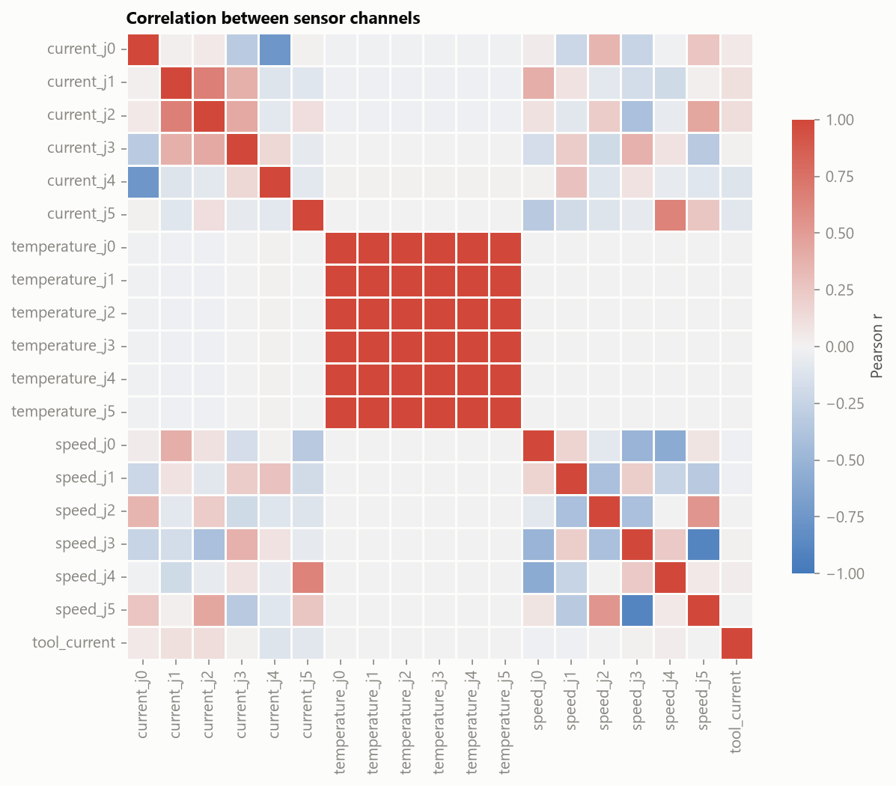

# cobot-fault-prediction

Predicting faults on a UR3 collaborative robot arm from its joint currents, temperatures and speeds, so issues like protective stops and lost grips can be caught before they disrupt operation.


An end-to-end machine learning project on real sensor data from an industrial cobot: data cleaning, physics-informed exploratory analysis, time-aware modelling with scikit-learn, experiment tracking with MLflow, and a FastAPI service, all packaged with Docker.

> **Status:** milestone 1 of 4 (data foundation and EDA) is done. See the [roadmap](#roadmap).

---

## Contents

1. [What is a UR3 cobot?](#what-is-a-ur3-cobot)
2. [The dataset](#the-dataset)
3. [Problem framing](#problem-framing)
4. [What the data shows](#what-the-data-shows)
5. [Project structure](#project-structure)
6. [Getting started](#getting-started)
7. [Roadmap](#roadmap)
8. [Git workflow](#git-workflow)
9. [Citation and licence](#citation-and-licence)

---

## What is a UR3 cobot?

<p align="center">
  
  &nbsp;
  
</p>
<p align="center"><sub>
  <b>Left:</b> a UR5, the UR3's larger sibling from the same Universal Robots family, fitted with a gripper; the teach pendant with its red emergency-stop button sits below.
  Photo by GrowSkills Robotics, <a href="https://creativecommons.org/licenses/by-sa/4.0/">CC BY-SA 4.0</a>, via <a href="https://commons.wikimedia.org/wiki/File:Cobot.jpg">Wikimedia Commons</a> (cropped and resized).
  <b>Right:</b> the six joints J0–J5 as they appear in the dataset's columns.
</sub></p>

### Collaborative robots

A **collaborative robot (cobot)** is a robot built to work directly alongside people ([Wikipedia](https://en.wikipedia.org/wiki/Cobot)). Traditional industrial robots work behind fences instead.

What makes this possible is **power and force limiting**: the controller keeps contact forces within the limits of ISO/TS 15066 and stops the arm when a limit is exceeded ([UR Safety FAQ](https://www.universal-robots.com/articles/ur/safety/safety-faq/)).

### The UR3

The UR3 is Universal Robots' compact, table-top arm. It has six rotating joints in a chain: **base, shoulder, elbow, wrist 1, wrist 2 and wrist 3**. This dataset calls them **J0–J5**, in the same order UR's own interfaces report them ([URScript manual](https://www.universal-robots.com/manuals/EN/HTML/SW5_24/Content/prod-scriptmanual/all_scripts/get_actual_joint_positio.htm)). Three joints position the tool in space and three orient it.

| | UR3 (CB3 series) |
|---|---|
| Joints / degrees of freedom | 6 rotating joints |
| Payload | 3 kg |
| Reach | 500 mm |
| Weight | 11 kg |
| Repeatability | ±0.1 mm |
| Joint speed | wrists 360°/s, other joints 180°/s |

Source: [UR3 technical specifications](https://www.universal-robots.com/media/240787/ur3_us.pdf). The dataset doesn't name the series; the reach and repeatability quoted in the authors' paper match the CB3 UR3 rather than the newer UR3e. The comparison is in [`docs/ur3.md`](docs/ur3.md).

### Protective stops

A **protective stop** is raised when the controller detects that the arm cannot follow its planned path ([UR: Understanding protective stops](https://www.universal-robots.com/articles/ur/robot-care-maintenance/understanding-protective-stops/)). Common causes are collisions, a payload that doesn't match the configuration, cables dragging on the arm, and joint or safety limits being hit.

The arm decelerates and halts with motor power still on, unlike an emergency stop, which cuts power and engages the brakes. An operator must then deliberately resume it. Every protective stop is lost cycle time plus a manual intervention, which is why seeing one coming is valuable.

### Why the sensors matter

Each joint's motor produces torque roughly in proportion to its current (**τ ≈ kₜ·I**). So the joint currents behave like torque sensors: they reflect gravity load, acceleration, and anything the arm is pushing against. Temperatures integrate that electrical load over time (P = I²R), and speeds show whether a joint is moving.

### In short

A UR3 is a six-joint cobot whose controller halts the arm with a protective stop when something prevents it from following its path. Its joint currents, temperatures and speeds describe what the arm is doing and what it is working against. That makes them the natural inputs for a model that tries to spot a stop before it happens.

➡️ The full primer, with specs, stop codes, data interfaces and all sources, is in [`docs/ur3.md`](docs/ur3.md).

---

## The dataset

[**UR3 CobotOps**](https://archive.ics.uci.edu/dataset/963/ur3+cobotops) was donated to the UCI Machine Learning Repository in 2024 by Tyrovolas, Aliev, Antonelli and Stylios (DOI [10.24432/C5J891](https://doi.org/10.24432/C5J891)). It was recorded from a UR3 through its RTDE and MODBUS interfaces. The timestamps in the file show two sessions on 26 October 2022, sampled at about 1 Hz.

| Group | Columns | Unit |
|---|---|---|
| Joint currents | `Current_J0` … `Current_J5` | A |
| Joint temperatures | `Temperature_T0`, `Temperature_J1` … `Temperature_J5` | °C |
| Joint speeds | `Speed_J0` … `Speed_J5` | rad/s |
| Gripper | `Tool_current` | A |
| Process | `cycle` (operation cycle counter), `Timestamp` | |
| **Targets** | `Robot_ProtectiveStop`, `grip_lost` | 0/1 |

### Cleaning

The raw spreadsheet needed real work. Every fix lives in [`cobot.data.clean`](src/cobot/data.py) and is unit-tested:

| Issue in the raw file | Fix |
|---|---|
| A column named `cycle ` with a trailing space; mixed casing | Strip names and convert to snake_case |
| Joint 0's temperature is named `Temperature_T0` | Rename to `temperature_j0` |
| 863 timestamps wrapped in literal `"` quotes | Strip quotes, parse as UTC datetimes |
| 46 rows with every sensor missing | Drop them |
| 8 rows that kept only `Current_J0` | Forward-fill within the session (the previous 1 Hz sample is the best estimate) |
| 1,802 speed values like `1e-44` | Set to exactly 0: float noise where the joint is at rest |
| One target is a float with NaNs, the other a bool | Cast both to integers |

Result: 7,409 raw rows become **7,363 clean rows** with no missing values, split into **two recording sessions** (49 and 76 minutes) about five hours apart.

> **Getting the data.** The data isn't committed to the repo; [`scripts/download_data.py`](scripts/download_data.py) fetches it and checks a SHA-256 checksum. The usual `ucimlrepo` loader doesn't work for this dataset (UCI returns `DatasetNotFoundError` for id 963), so the script downloads the archive from UCI's static file URL. That URL is not an official API. If it ever moves, download the zip manually from the [dataset page](https://archive.ics.uci.edu/dataset/963/ur3+cobotops) and place `dataset_02052023.xlsx` in `data/raw/`; the checksum still verifies it.

---

## Problem framing

The obvious approach is to train a classifier to predict `Robot_ProtectiveStop` from the sensor readings in the *same row*. That leaks the answer:

<p align="center"></p>

Once a stop fires, the controller brakes the arm, so mean joint speed collapses by roughly an order of magnitude. A same-row classifier would mostly learn "the arm isn't moving". Its scores would look excellent, but it could never warn anyone.

**So the task is forecasting.** The label at time *t* is *"a protective stop starts within the next 5 seconds"*:
- Features use only samples up to *t*.
- Rows already inside a stop are excluded.
- `grip_lost` is a secondary target with the same framing.

The model is still a classifier (a Random Forest, compared against simple baselines), but now it does something useful.

Is a 5 s warning realistic? Aligning all 107 complete stop events on their onset shows that the signal is there:

<p align="center"></p>

Total joint current rises from a ~4.3 A baseline to ~6.7 A over the 2–3 s before a protective stop. Since current is a proxy for torque, the arm is working against something before the controller gives up. Grip losses show no comparable precursor in these channels, so they're expected to be the harder target.

---

## What the data shows

The full analysis is in [`notebooks/01_eda.ipynb`](notebooks/01_eda.ipynb). Highlights:

<p align="center"></p>

- **Faults are rare and short.** 3.8% of rows are protective stops (108 events) and 3.3% are grip losses (74 events), with a median event length of 2 s. The modelling has to handle imbalanced classes: PR-AUC and recall, never accuracy.
- **The morning session is a thermal warm-up.** Every joint heats by 6–10 °C, while the afternoon session sits near equilibrium. Stops are more frequent in the afternoon, so absolute temperature is confounded with time of day. Features use the *rate* of temperature change, and the test set is always the latest data.
- **The physics checks out.** At standstill the shoulder (J1, −2.1 A) and elbow (J2, −1.0 A) draw holding current against gravity while the base draws about 0 A, which is static torque balance seen through a current sensor. Raw currents therefore carry pose-dependent offsets, so features focus on changes.
- **The temperatures are redundant.** All six correlate at r ≥ 0.99, so they carry one signal, not six.

<p align="center">
  
  
</p>

---

## Project structure

```
cobot-fault-prediction/
├── configs/config.yaml        # data source, checksum and settings (no magic numbers in code)
├── data/raw/                  # downloaded dataset (gitignored)
├── docs/
│   ├── ur3.md                 # the UR3 primer with sources
│   └── img/                   # figures used in this README
├── notebooks/01_eda.ipynb     # exploratory analysis; imports from src/
├── scripts/download_data.py   # fetch + checksum the raw data
├── src/cobot/
│   ├── config.py              # typed config (pydantic) loaded from YAML
│   ├── data.py                # download, load and clean
│   ├── labels.py              # fault events -> prediction targets
│   └── plotting.py            # shared, colour-blind-safe figure style
├── tests/                     # pytest unit tests
├── pyproject.toml / uv.lock   # dependencies (uv)
└── .pre-commit-config.yaml    # ruff lint + format on every commit
```

Coming in later milestones: `features.py` (scikit-learn transformers), `splits.py` (time-aware cross-validation), `models.py`, `evaluate.py`, `train.py`, a FastAPI app, a `Dockerfile`, `docker-compose.yml` (MLflow and the API) and GitHub Actions CI.

**Design principles:**
- Reusable logic lives in a small, typed package; notebooks only explore.
- Configuration is in one validated YAML file.
- Feature steps will be scikit-learn transformers, so the whole pipeline is a single object that can be trained, logged and served.
- Every data transformation has a test.

---

## Getting started

Requires [uv](https://docs.astral.sh/uv/) and Python 3.12.

```bash
git clone https://github.com/mariamaraki-satorianalytics/cobot-fault-prediction.git
cd cobot-fault-prediction
uv sync                                   # create .venv and install everything
uv run python scripts/download_data.py    # fetch the dataset into data/raw/
uv run pytest                             # run the test suite
uv run pre-commit install                 # lint and format on every commit
```

Open `notebooks/01_eda.ipynb` in VS Code or Jupyter with the `.venv` kernel to explore the data.

---

## Roadmap

| Milestone | Scope | Status |
|---|---|---|
| **M1: data foundation** | uv project, download and cleaning with tests, EDA notebook, README and UR3 primer | ✅ done |
| **M2: modelling** | Onset labels, physics and rolling-window features (with a leakage test), time-aware CV, baselines vs. Random Forest, evaluation plots, MLflow tracking | ⏳ next |
| **M3: MLflow in Docker** | `docker compose` MLflow server, model registry with a `champion` alias | |
| **M4: serving and CI** | FastAPI `/predict` and `/health`, Dockerfile, GitHub Actions (lint, test, build) | |

---

## Git workflow

- `main` holds released milestones; `dev` is the integration branch.
- Work is committed to `dev` (or short-lived feature branches off it) and merged into `main` through a pull request at the end of each milestone.
- Commit messages follow [Conventional Commits](https://www.conventionalcommits.org/) (`feat:`, `fix:`, `docs:`, `test:`, `chore:`).
- Pre-commit hooks run ruff (lint and format) and basic file checks before every commit.

---

## Citation and licence

The code is released under the [MIT License](LICENSE).

The dataset is © its authors and licensed under [CC BY 4.0](https://creativecommons.org/licenses/by/4.0/). It isn't redistributed here. If you use it, please cite:

```bibtex
@misc{ur3_cobotops,
  author       = {Tyrovolas, Marios and Aliev, Khurshid and Antonelli, Dario and Stylios, Chrysostomos},
  title        = {{UR3 CobotOps}},
  year         = {2024},
  howpublished = {UCI Machine Learning Repository},
  doi          = {10.24432/C5J891}
}

@inproceedings{tyrovolas2024fcm,
  author    = {Tyrovolas, Marios and Stylios, Chrysostomos and Aliev, Khurshid and Antonelli, Dario},
  title     = {Leveraging Information Flow-Based Fuzzy Cognitive Maps for Interpretable Fault Diagnosis in Industrial Robotics},
  booktitle = {15th Advanced Doctoral Conference on Computing, Electrical and Industrial Systems (DoCEIS 2024)},
  series    = {IFIP Advances in Information and Communication Technology},
  volume    = {716},
  pages     = {98--110},
  publisher = {Springer},
  year      = {2024},
  doi       = {10.1007/978-3-031-63851-0_6}
}
```

The cobot photo in `docs/img/ur5_cobot_growskills.jpg` is a cropped, resized version of [Cobot.jpg](https://commons.wikimedia.org/wiki/File:Cobot.jpg) by GrowSkills Robotics. It is licensed under [CC BY-SA 4.0](https://creativecommons.org/licenses/by-sa/4.0/), not the MIT License, and the adapted version carries the same licence.

UR3 background facts link to Universal Robots' public documentation; Universal Robots is not affiliated with this project.
