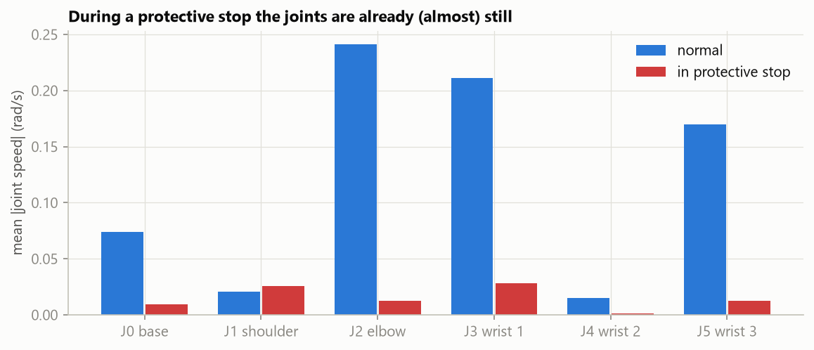
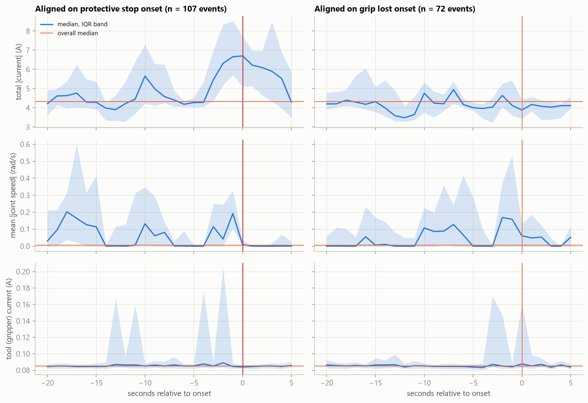
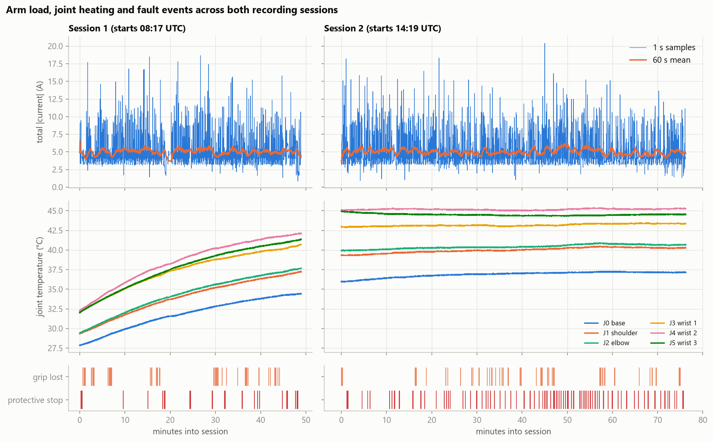
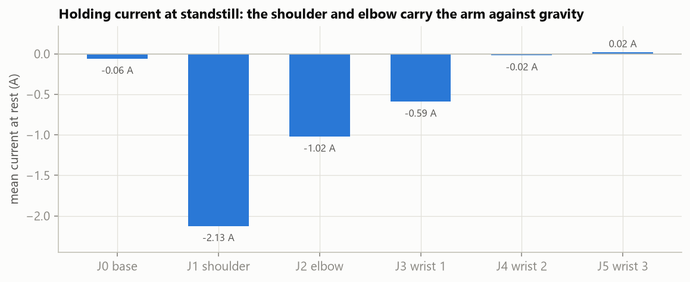
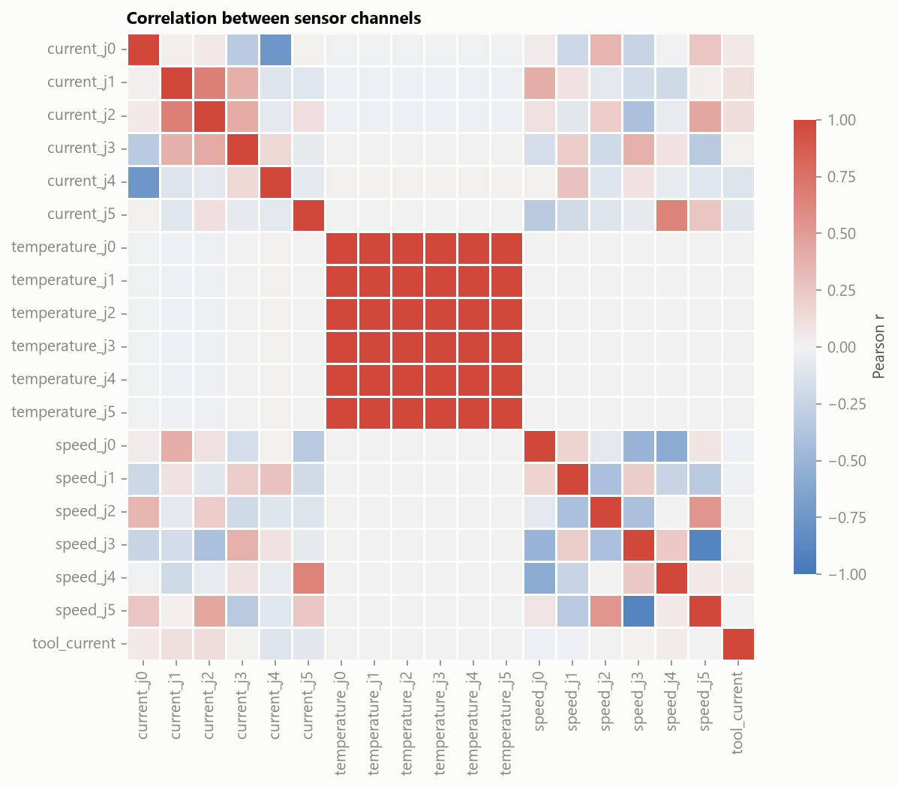

# Problem framing and EDA findings

A summary of what the exploratory analysis found and how it shapes the model. The full analysis, with the code behind every figure, is in [`notebooks/01_eda.ipynb`](../notebooks/01_eda.ipynb).

## Problem framing

The obvious approach is to train a classifier to predict `Robot_ProtectiveStop` from the sensor readings in the *same row*. That leaks the answer:

Once a stop fires, the controller brakes the arm, so mean joint speed collapses by roughly an order of magnitude. A same-row classifier would mostly learn "the arm isn't moving". Its scores would look excellent, but it could never warn anyone.

**So the task is forecasting.** The label at time *t* is *"a protective stop starts within the next 5 seconds"*:
- Features use only samples up to *t*.
- Rows already inside a stop are excluded.
- `grip_lost` is a secondary target with the same framing.

The model is still a classifier (a Random Forest, compared against simple baselines), but now it does something useful.

Is a 5 s warning realistic? Aligning all 107 complete stop events on their onset shows that the signal is there:

Total joint current rises from a ~4.3 A baseline to ~6.7 A over the 2–3 s before a protective stop. Since current is a proxy for torque, the arm is working against something before the controller gives up. Grip losses show no comparable precursor in these channels, so they're expected to be the harder target.

## What the data shows

- **Faults are rare and short.** 3.8% of rows are protective stops (108 events) and 3.3% are grip losses (74 events), with a median event length of 2 s. The modelling has to handle imbalanced classes: PR-AUC and recall, never accuracy.
- **The morning session is a thermal warm-up.** Every joint heats by 6–10 °C, while the afternoon session sits near equilibrium. Stops are more frequent in the afternoon, so absolute temperature is confounded with time of day. Features use the *rate* of temperature change, and the test set is always the latest data.
- **The physics checks out.** At standstill the shoulder (J1, −2.1 A) and elbow (J2, −1.0 A) draw holding current against gravity while the base draws about 0 A, which is static torque balance seen through a current sensor. Raw currents therefore carry pose-dependent offsets, so features focus on changes.
- **The temperatures are redundant.** All six correlate at r ≥ 0.99, so they carry one signal, not six.

  
  

