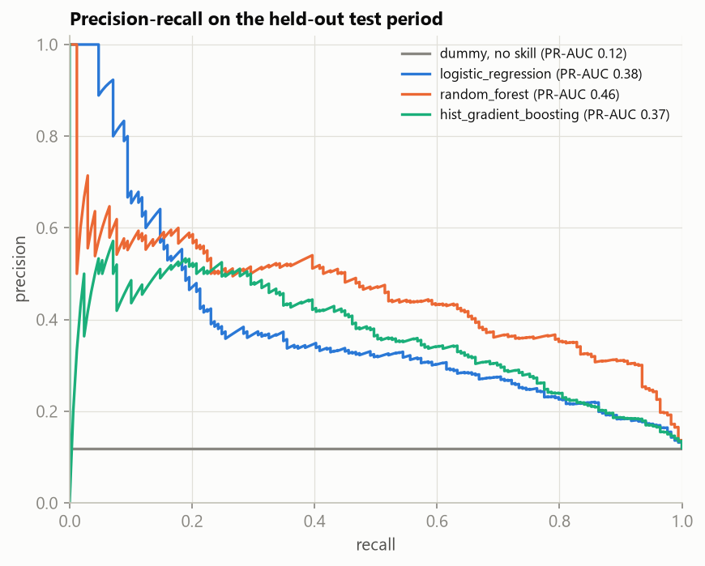
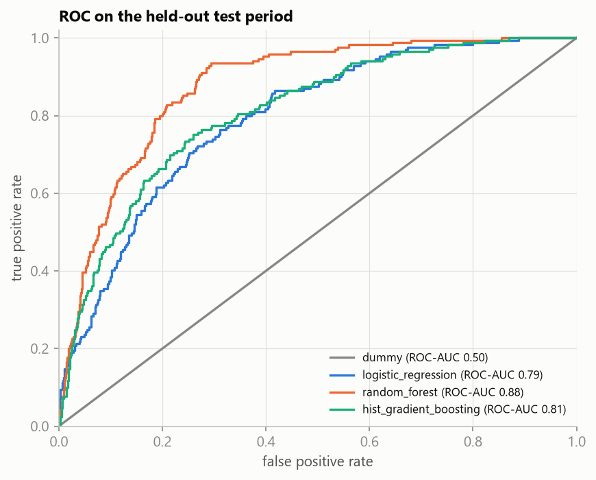
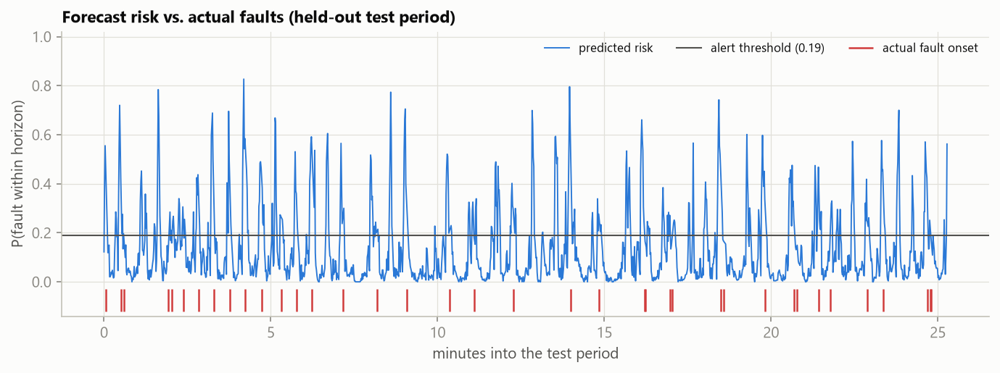
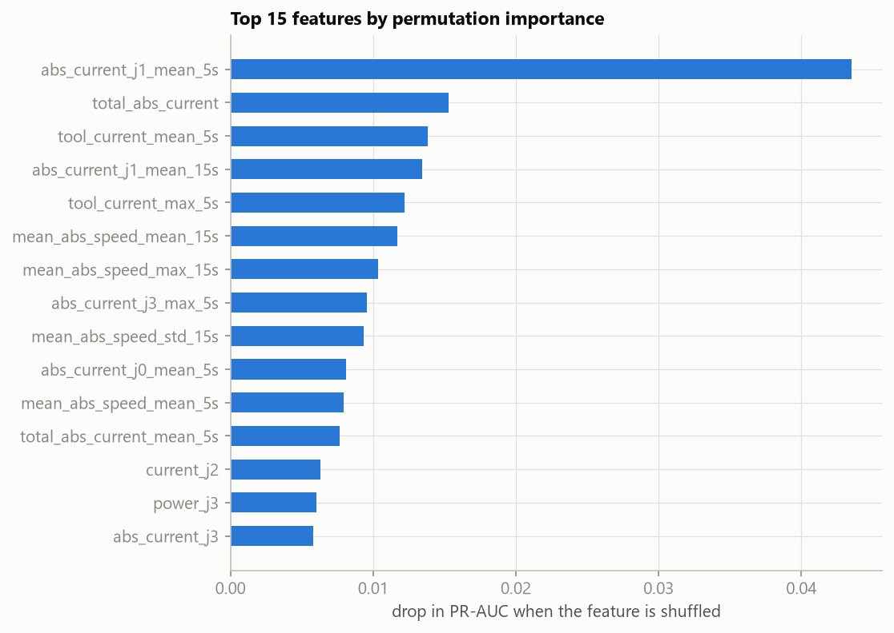
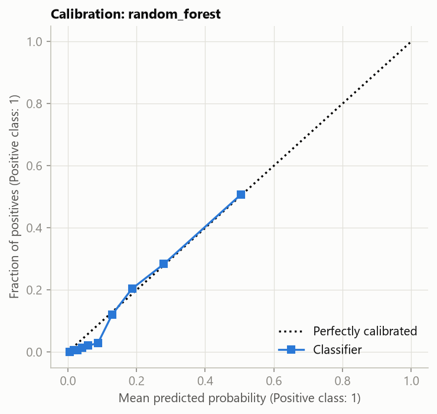
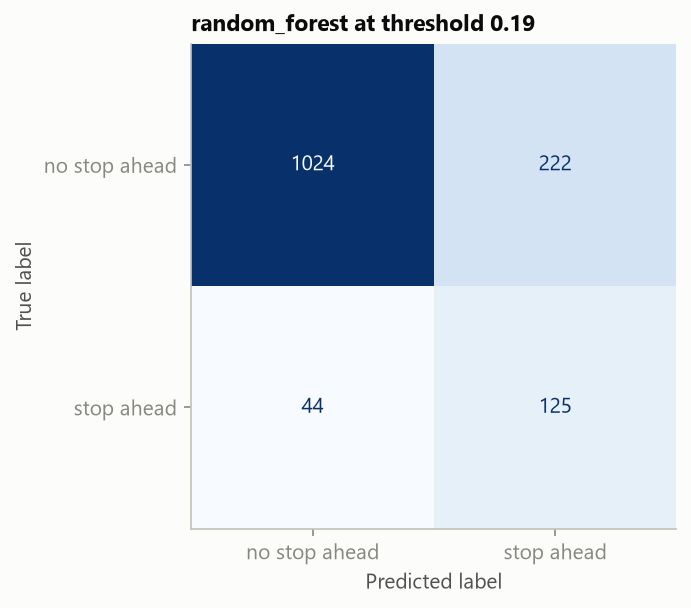

# Modelling results

How well can a model warn of a fault **up to 5 seconds before it starts**, from joint currents, speeds and temperatures alone? The framing and the EDA behind it are in [`analysis.md`](analysis.md). This page covers the method and the results. Every number here comes from `uv run cobot-train` and is logged in MLflow.

## Method

| Step | What happens | Code |
|---|---|---|
| Labels | `y = 1` if a fault onset falls in the next 5 samples (~5 s). Samples already inside a fault, and the last 5 of each session, are left out. | [`labels.py`](../src/cobot/labels.py) |
| Features | 92 features. **Physics:** \|I\| per joint (torque proxy), \|I\|·\|ω\| (power proxy), total arm current, joints moving. **Temporal:** 5 s and 15 s rolling mean/std/max and first differences of the load signals, plus the heating *rate*. Absolute temperatures are dropped (confounded with time of day). Everything is computed per session from past samples only, and a unit test enforces that. | [`features.py`](../src/cobot/features.py) |
| Split | The latest 20% of the data (~24 min of the afternoon session) is held out as the test set and used only for the final report. | [`train.py`](../src/cobot/train.py) |
| Validation | Forward-chaining `TimeSeriesSplit` (5 folds, with a 5-sample gap so a training label never peeks into its validation fold). Used for model selection, the random-forest hyperparameter search and the alert threshold. | [`train.py`](../src/cobot/train.py) |
| Models | Prior-only baseline, logistic regression, random forest (tuned with `RandomizedSearchCV`), histogram gradient boosting. Class weights handle the imbalance. | [`models.py`](../src/cobot/models.py) |
| Threshold | The cut-off that maximises F1 on the out-of-fold predictions, chosen *before* the test set is seen. | [`evaluate.py`](../src/cobot/evaluate.py) |

**Metrics.** PR-AUC is the headline metric, because positives are rare and accuracy would be meaningless. Two operational metrics go with it:
- **event recall:** the share of faults that got at least one alert in the 5 s before them;
- **false alarms per hour:** separate alert episodes with no fault behind them.

## Protective stops (main target)

The tuned random forest (`max_depth=16`, `min_samples_leaf=5`, `max_features=sqrt`, 200 trees) was the best model in cross-validation. The test period it was scored on has 38 stop onsets.

| Model | PR-AUC | ROC-AUC | Precision | Recall | Event recall | False alarms / h |
|---|---|---|---|---|---|---|
| Baseline (class prior) | 0.12 | 0.50 | | | | |
| Logistic regression | 0.38 | 0.79 | 0.32 | 0.50 | 0.76 | 170 |
| **Random forest** | **0.46** | **0.88** | 0.36 | 0.74 | **0.87** | **130** |
| Hist. gradient boosting | 0.37 | 0.81 | 0.28 | 0.75 | 0.84 | 226 |

<p align="center">
  
  
</p>

**What this means.**
- The random forest ranks the "stop ahead" moments almost **4× better than chance** (PR-AUC 0.46 vs. 0.12).
- At its F1-optimal threshold it warned of **33 of the 38 stops** in the test period.
- The price is about 51 false-alarm episodes in the same ~24 minutes, a little over one per real stop. Useful as an early-warning signal, not yet as an automatic intervention.

<p align="center"></p>

Risk spikes line up with most stop onsets (red ticks), but there are also spikes with no stop behind them.

<p align="center">
  
  
</p>

- **The physics shows up in the model.** The most important feature by far is the shoulder (J1) current averaged over the last 5 s, followed by total arm current. That is the joint carrying the most load, and the EDA showed current climbing just before a stop. Gripper current and joint-speed statistics follow.
- **The probabilities are reasonably calibrated**, so a predicted 0.3 means roughly a 30% chance of a stop within 5 s. That makes the threshold a meaningful operating knob rather than an arbitrary score.

<p align="center"></p>

## Grip losses (secondary target)

| Model | PR-AUC | ROC-AUC | Event recall | False alarms / h |
|---|---|---|---|---|
| Baseline (class prior) | 0.04 | 0.50 | | |
| Logistic regression | 0.10 | 0.68 | 0.50 | 104 |
| Random forest *(best in CV)* | 0.17 | 0.77 | 0.36 | 33 |
| Hist. gradient boosting | 0.21 | 0.78 | 0.57 | 96 |

As the EDA predicted, grip losses are much harder: the joint and gripper signals show no clear precursor. The models still beat chance (PR-AUC 0.17–0.21 vs. 0.04), but the test period contains only 14 grip-loss events, so these numbers are noisy. Cross-validation PR-AUC (0.44 for the forest) is also far above test, a sign that grip-loss behaviour shifted between the morning and afternoon sessions. All grip-loss figures are logged in MLflow and saved as `docs/img/results_grip_lost_*.png`.

## Limitations

- **The random forest's cross-validation score is optimistic.** Its hyperparameters were tuned on the same five folds that produced the CV PR-AUC used to choose it over the untuned models. The held-out test numbers above don't have this bias, which is why they are the ones reported.
- **One day, one robot, two sessions.** The model has seen 71 stop events in training. It would need data from more days, programs and payloads before anyone relied on it.
- **The test period has a higher stop rate** than training (11.9% vs. 5.9% of samples), so absolute PR-AUC values across periods aren't comparable; the lift over the baseline is.
- **~1 Hz sampling** limits how early and how precisely a precursor can be seen. The controller logs far faster than the published data.
- **False alarms are the main weakness.** Lowering them is the obvious next step:
  - smoothing the alert (e.g. requiring 2 consecutive high-risk seconds);
  - choosing the threshold for a target alarm rate instead of F1;
  - adding the robot program state, if it were available.

## Reproducing

```bash
uv run cobot-train --save-figures                      # protective stops
uv run cobot-train --target grip_lost --save-figures   # grip losses
uv run mlflow ui --backend-store-uri sqlite:///mlflow.db
```

Each run logs, per candidate model:
- its parameters;
- cross-validation and test metrics;
- every figure;
- the winning pipeline (features + model, raw readings in, probability out).
